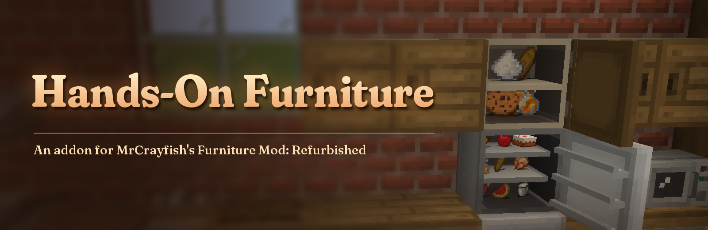
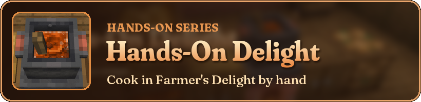
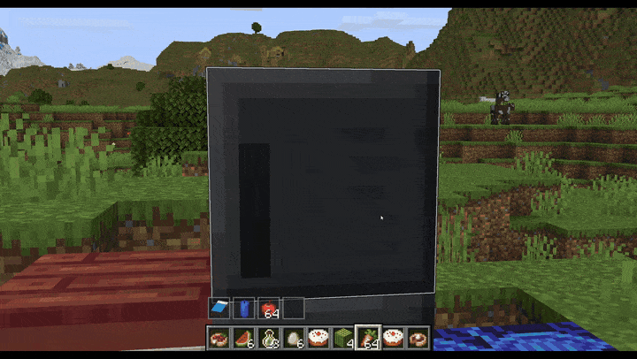
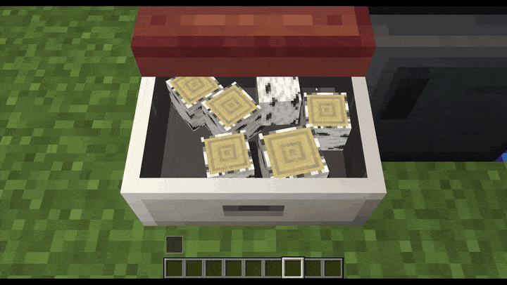

<!-- CurseForge description of Hands-On Furniture. HTML: paste it in the editor's HTML (source) mode, not Markdown mode.
     The "more-mods" block is generated by tools/mod-catalog/sync_mod_links.py - never edit it by hand. -->

<!-- more-mods:start family -->

 &nbsp;

<!-- more-mods:end -->

    

<em>Open the kitchen of <a href="https://www.curseforge.com/minecraft/mc-mods/refurbished-furniture">MrCrayfish's Furniture Mod: Refurbished</a> with your own hands.</em>

<strong>The fridge, the freezer, the kitchen cabinets and drawers open right where they stand, with no menu screen. You swing the door open, pull the drawer out and put your food on the shelves where you want it, turned and stacked as you like. It stays there, and every player sees it.</strong>

<strong>No menus</strong>, the doors open in the world &nbsp;&middot;&nbsp; <strong>No slot limit</strong>, only the room on the shelves &nbsp;&middot;&nbsp; <strong>No new blocks or items</strong>

<h2 style="text-align:center">The fridge and the freezer</h2>

<em>Use the fridge and its door comes unstuck from the seal and swings open about as far as a hand leaves it. Food stands on two shelves and in the three bins of the door, and turns along with it when the door moves. The freezer under the fridge opens the same way, with what freezes in it and what came out frozen.</em>

<h2 style="text-align:center">Cabinets and drawers</h2>

<em>A kitchen drawer has an upper and a lower drawer, each pulled out on its own, and the camera follows the one you pull. A kitchen cabinet swings its door open on its hinge and is seen from the side the door leaves free.</em>

<h2 style="text-align:center">The microwave and the oven</h2>

<em>Things stand on the microwave's plate. Flip the switch on its panel and the plate turns while it heats, with what stands on it. The stove's oven door comes down level, with a floor and a rack inside. Turn the knob on the hob and the element at the back glows: with power, the oven bakes three things at a time, wherever they stand.</em>

<h2 style="text-align:center">The electricity generator</h2>

<em>Its side panel swings out on a firebox. Lay coal or any other fuel on the grate and press the key under the screen: the embers glow while it burns one at a time, and the screen shows how much of the burning fuel is left.</em>

<h2 style="text-align:center">The mail box</h2>

<em>Its front comes down and the mail lies on the floor inside. Letting the front down checks the mail: the flag goes down, as with Refurbished's menu.</em>

<h2 style="text-align:center">Put things anywhere</h2>

<em>Things stand where you put them. The mouse wheel turns them, with Shift it tilts them and with Control it makes them bigger or smaller, and pointing at the top of a thing puts the next one on it. What you carry rises onto things and never knocks them over.</em>

<h2 style="text-align:center">Weight and room</h2>

<em>A stone block shoves an apple aside, an apple hardly moves the block, and a block set on its edge falls over. There is no slot limit, only the room on the shelves: whatever is crowded over the edge falls out into your inventory. A lantern or a glowing block on a shelf lights up the inside.</em>

<h3 style="text-align:center">Getting started</h3>

Put the mod, <a href="https://www.curseforge.com/minecraft/mc-mods/refurbished-furniture">Refurbished</a> and <a href="https://www.curseforge.com/minecraft/mc-mods/diegesis">Diegesis</a> into the mods folder of the client and the server, then right-click a fridge. On <a href="https://fabricmc.net">Fabric</a> it also needs <a href="https://www.curseforge.com/minecraft/mc-mods/fabric-api">Fabric API</a>. A client without the mod keeps Refurbished's own menus. The things stay in the furniture's own storage: hoppers fill and empty it, and breaking it drops what it holds.

 Bug reports, questions and ideas for the next furniture are welcome in <a href="https://discord.gg/mGkPKccJEf">Pocky's Kitchen</a>, our Discord server.

Made by <strong>Pocky</strong>, the maker of <a href="https://www.curseforge.com/minecraft/mc-mods/hands-on-delight">Hands-On Delight</a> and <a href="https://www.curseforge.com/minecraft/mc-mods/hands-on-vanilla">Hands-On Vanilla</a>. Built on <a href="https://www.curseforge.com/minecraft/mc-mods/diegesis">Diegesis</a>. The furniture and its textures are MrCrayfish's, from <a href="https://www.curseforge.com/minecraft/mc-mods/refurbished-furniture">Refurbished</a>. Source on <a href="https://github.com/Pocky-l/handson-furniture">GitHub</a> (MIT).

