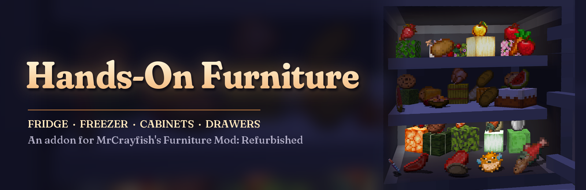
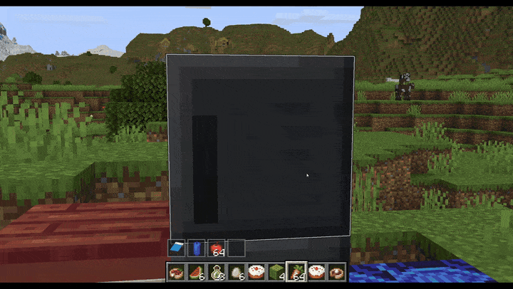
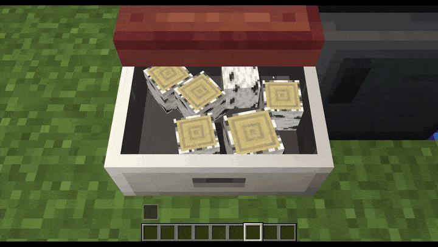

<p align="center">
  
</p>

<p align="center">
  <a href="https://www.curseforge.com/minecraft/mc-mods/hands-on-furniture"></a>
  <a href="https://www.curseforge.com/minecraft/mc-mods/hands-on-furniture/files"></a>
  <a href="https://files.minecraftforge.net"></a>
  <a href="https://neoforged.net"></a>
  <a href="https://fabricmc.net"></a>
  <a href="https://discord.gg/mGkPKccJEf"></a>
  <a href="LICENSE"></a>
</p>

<p align="center"><i>Open your kitchen with your own hands.</i></p>

<p align="center"><b>The fridge, the freezer, the kitchen cabinets and drawers of MrCrayfish's Furniture Mod: Refurbished open right where they stand, with no menu screen. Put your food on the shelves where you want it, turned and stacked as you like, and it stays there for everyone to see.</b></p>

<p align="center"></p>

<p align="center"></p>

<p align="center"><b>No menus</b>, the doors open in the world &middot; <b>No slot limit</b>, only the room on the shelves &middot; <b>No new blocks or items</b></p>

An addon for [MrCrayfish's Furniture Mod: Refurbished](https://www.curseforge.com/minecraft/mc-mods/refurbished-furniture),
built on [Diegesis](https://www.curseforge.com/minecraft/mc-mods/diegesis), from the maker of
[Hands-On Delight](https://www.curseforge.com/minecraft/mc-mods/hands-on-delight) and
[Hands-On Vanilla](https://www.curseforge.com/minecraft/mc-mods/hands-on-vanilla).

## Features

- **Fridge.** Use it and its door comes unstuck from the seal and swings part way open. Food stands on its two shelves
  and in the three bins of the door, and turns along with the door.
- **Freezer.** The lower block under the fridge opens the same way; what freezes in it and what came out frozen stand on
  its shelves.
- **Kitchen cabinets.** The door swings open on its hinge and the camera looks in from the side it leaves free.
- **Kitchen drawers.** Two drawers, the upper and the lower one, each pulled out on its own. The camera follows the one
  you pull out.
- **Put things anywhere.** Things stand where you put them, turned and sized as you like, even on top of each other. They
  stay there, and every player sees them.
- **Weight.** A stone block shoves an apple aside, an apple hardly moves the block. Things stop where they land, a block
  set on its edge falls over, and what stood on a thing comes down when you take that thing away.
- **No slot limit.** Put in as much as fits on the shelves. Whatever is crowded over the edge falls out into your
  inventory, or onto the floor when your inventory is full.
- **Small touches.** Things in the fridge and the freezer are smaller, so two fit one above the other under a shelf.
  Cans and bottles from food mods stand upright, and a lantern or torch on a shelf lights up the inside.
- **Nothing breaks.** The things stay in the furniture's own storage: hoppers fill and empty it, breaking it drops what it
  holds, and players without the mod still get its menu.

## Controls

| Action | How |
|---|---|
| Open the furniture | Right-click it |
| Open or shut a door or drawer | Click it |
| Put a stack in | Click it in your inventory, then the spot on a shelf |
| Put it on top of a thing | Point at the top of that thing |
| Turn it | Mouse wheel; Shift + wheel tips it towards you |
| Make it bigger or smaller | Control + wheel |
| Push a thing | Drag it with the left button |
| Turn a thing in place | Drag it with the right button |
| Put a stack away / take it back | Shift + click it |
| Leave | Escape or the inventory key |

## Installation

1. Minecraft 1.20.1 with [Forge](https://files.minecraftforge.net), Minecraft 1.21.1 with
   [NeoForge](https://neoforged.net), or either of them with [Fabric](https://fabricmc.net) and
   [Fabric API](https://www.curseforge.com/minecraft/mc-mods/fabric-api).
2. [MrCrayfish's Furniture Mod: Refurbished](https://www.curseforge.com/minecraft/mc-mods/refurbished-furniture),
   [Diegesis](https://www.curseforge.com/minecraft/mc-mods/diegesis) and this mod in the `mods` folder of the server and
   the client.

Bug reports, questions and ideas for the next furniture are welcome in [Pocky's Kitchen](https://discord.gg/mGkPKccJEf),
our Discord server.

## Building

```sh
./gradlew build
```

The jars are written to `forge/build/libs/` and `fabric/build/libs/` (on the `1.21.1` branch `neoforge/` and `fabric/`).

## Credits

- Author: **Pocky**.
- Built on [Diegesis](https://www.curseforge.com/minecraft/mc-mods/diegesis). The furniture, its models and its textures
  are MrCrayfish's, from [Refurbished](https://www.curseforge.com/minecraft/mc-mods/refurbished-furniture), and are not
  part of this mod: it draws them from Refurbished at runtime. The shelves, bins and trays inside are this mod's own.

<!-- more-mods:start -->
## More mods by Pocky

**🌦️ Weather & nature**

<table>
  <tr>
    <td width="56"><a href="https://www.curseforge.com/minecraft/mc-mods/hoarfrost-snow-blizzards"></a></td>
    <td><a href="https://www.curseforge.com/minecraft/mc-mods/hoarfrost-snow-blizzards"><b>Hoarfrost: Snow & Blizzards</b></a> - seven kinds of snowfall, a living wind and soft snow on the land (<a href="https://github.com/Pocky-l/hoarfrost">source</a>)</td>
  </tr>
  <tr>
    <td width="56"><a href="https://www.curseforge.com/minecraft/mc-mods/petrichor-rain-storms"></a></td>
    <td><a href="https://www.curseforge.com/minecraft/mc-mods/petrichor-rain-storms"><b>Petrichor: Rain & Storms</b></a> - realistic rain, puddles, drips and branching lightning (<a href="https://github.com/Pocky-l/petrichor">source</a>)</td>
  </tr>
  <tr>
    <td width="56"><a href="https://www.curseforge.com/minecraft/mc-mods/rustling-leaves"></a></td>
    <td><a href="https://www.curseforge.com/minecraft/mc-mods/rustling-leaves"><b>Rustling Leaves</b></a> - falling leaves and leaf piles you can wade through and rake, client-side (<a href="https://github.com/Pocky-l/rustling-leaves">source</a>)</td>
  </tr>
</table>

**🎨 Graphics & performance**

<table>
  <tr>
    <td width="56"><a href="https://www.curseforge.com/minecraft/mc-mods/turbo-for-distant-horizons"></a></td>
    <td><a href="https://www.curseforge.com/minecraft/mc-mods/turbo-for-distant-horizons"><b>Turbo for Distant Horizons</b></a> - Distant Horizons terrain generated several times faster (<a href="https://github.com/Pocky-l/dhturbo">source</a>)</td>
  </tr>
  <tr>
    <td width="56"><a href="https://www.curseforge.com/minecraft/shaders/pocky-shaders"></a></td>
    <td><a href="https://www.curseforge.com/minecraft/shaders/pocky-shaders"><b>Pocky Shaders</b></a> - a cosy, natural shader pack that shows the weather of these mods (<a href="https://github.com/Pocky-l/pocky-shaders">source</a>)</td>
  </tr>
</table>

**🔮 Magic**

<table>
  <tr>
    <td width="56"><a href="https://www.curseforge.com/minecraft/mc-mods/hextale"></a></td>
    <td><a href="https://www.curseforge.com/minecraft/mc-mods/hextale"><b>HexTale</b></a> - hextech magic to research, distil and bind with runes, inspired by Arcane and Thaumcraft (<a href="https://github.com/Pocky-l/HexTale">source</a>)</td>
  </tr>
</table>

**⚡ Tech & energy**

<table>
  <tr>
    <td width="56"><a href="https://www.curseforge.com/minecraft/mc-mods/mekanism-advancedgenerators"></a></td>
    <td><a href="https://www.curseforge.com/minecraft/mc-mods/mekanism-advancedgenerators"><b>Mekanism Advanced Generators</b></a> - nine tiers of solar panels, big solar generators, cubes and cables for Mekanism (<a href="https://github.com/Pocky-l/Mekanism-MoreSolarPanels">source</a>)</td>
  </tr>
</table>

**🛠️ Server tools**

<table>
  <tr>
    <td width="56"><a href="https://www.curseforge.com/minecraft/mc-mods/inventory-backups"></a></td>
    <td><a href="https://www.curseforge.com/minecraft/mc-mods/inventory-backups"><b>Inventory Backups</b></a> - inventory and ender chest backups with one-click restore for admins (<a href="https://github.com/Pocky-l/inventory-backups">source</a>)</td>
  </tr>
</table>

**🧩 Libraries & addons**

<table>
  <tr>
    <td width="56"><a href="https://www.curseforge.com/minecraft/mc-mods/diegesis"></a></td>
    <td><a href="https://www.curseforge.com/minecraft/mc-mods/diegesis"><b>Diegesis</b></a> - a library for interfaces you work with right on the block, with no menu screen (<a href="https://github.com/Pocky-l/diegesis">source</a>)</td>
  </tr>
  <tr>
    <td width="56"><a href="https://www.curseforge.com/minecraft/mc-mods/hands-on-delight"></a></td>
    <td><a href="https://www.curseforge.com/minecraft/mc-mods/hands-on-delight"><b>Hands-On Delight</b></a> - cook in Farmer's Delight with your own hands, right on its blocks (<a href="https://github.com/Pocky-l/handson-delight">source</a>)</td>
  </tr>
  <tr>
    <td width="56"><a href="https://www.curseforge.com/minecraft/mc-mods/hands-on-vanilla"></a></td>
    <td><a href="https://www.curseforge.com/minecraft/mc-mods/hands-on-vanilla"><b>Hands-On Vanilla</b></a> - craft and smelt with your own hands, right on the crafting table and the furnace, client-side (<a href="https://github.com/Pocky-l/handson-vanilla">source</a>)</td>
  </tr>
</table>

<!-- more-mods:end -->

## License

[MIT](LICENSE)
